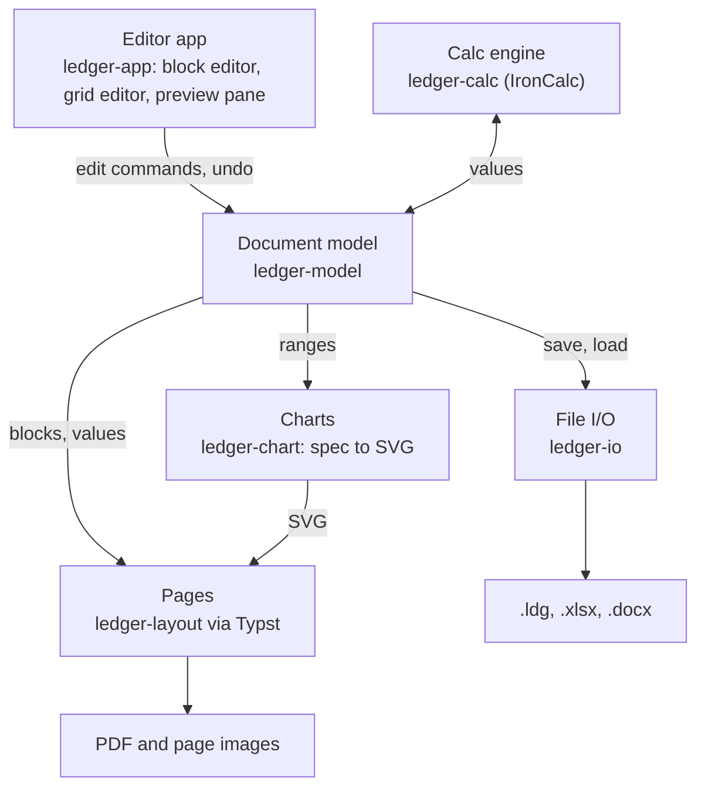

# Ledger: design spec and phased plan

As of 2026-11-25. Working name "Ledger"; the repository is DocuRevised. Living version: [Claude Doc](https://claude.ai/artifact/85BwWvW5hdzX4VEhU57sDJ). When the two differ, update this file and note the change in the deviations log.

## Summary

Ledger (working name) is a Rust desktop document writer in which tables are live spreadsheets and charts are bound to those tables, so a report never needs an Excel-to-Word copy again. One file holds the text, the numbers, the formulas and the charts. Changing one cell recalculates every dependent cell in every table, redraws the charts, and updates the printed pages.

**The problem it removes.** Today the workflow is: calculate in Excel, copy tables and charts into Word, fix numbers that come across distorted, then redo the whole round trip on every change. Building the report in Excel instead fails on pagination, formatting, and tables of different column counts on one page (for example a 6-column and a 9-column table, both at full page width).

**Recommended approach in one line.** An egui block editor (paragraphs, headings, tables, charts) over a single document model, a spreadsheet engine where each table is one sheet, and Typst as the layout and PDF engine for pages, with .xlsx and .docx export later.

**How to use this spec.** It follows the MicroParquet pattern: phases split into Claude Code sessions, each with tasks, acceptance items and tests, plus a log of accepted deviations. Start each session by pointing Claude Code at this spec and the session id (for example "Do P2-S1"). Items marked *(guess)* are assumptions to confirm in the Phase 0 spikes, not checked facts.

## Goals, non-goals and MVP scope

The MVP is a single-user desktop app that can produce one real treasury or finance report end to end: text, two or more linked tables of different widths on one page, one chart, and a print-ready PDF.

**Goals**

1. **One source of truth for numbers.** A value is stored once with its number format; what you see on screen, in the PDF and in any export is formatted from that same value, so nothing gets distorted.
2. **Tables that behave like spreadsheets.** Formulas, ranges, common functions, and references into other tables (`=Rates!C4`, `=SUM(Deposits!B2:B20)`).
3. **Tables that behave like Word tables.** Each table fits the page text width on its own, with column widths as relative weights, so a 6-column and a 9-column table sit on one page cleanly.
4. **Live charts.** A chart is bound to a table range and redraws when any input cell changes.
5. **Real pages.** A4 or Letter, margins, headers and footers, page numbers, page breaks, and tables that continue onto the next page with their header row repeated.
6. **Numbers in text.** A paragraph can show a live table value inline, for example "Total deposits stand at {Deposits!F12}".
7. **Money results without floating-point noise.** IronCalc computes in binary floating point, and every result is rounded on the way out: cells with a fixed-decimal format are rounded to those places before other cells use them, and everything else to 15 significant digits (decision D3), so a difference that should be zero shows as zero.
8. **Files that never get lost or silently broken.** A versioned file format from day one, atomic saves, and a recoverable backup.

**Non-goals for the MVP**

- Full Word-style editing directly on rendered pages (the MVP edits in a page-width view with a live page preview; see decision D1).
- Collaboration, comments, track changes.
- Opening .docx files, and full-fidelity .xlsx round trips.
- Macros, pivot tables, conditional formatting, array formulas.
- Images, footnotes, table of contents (Phase 7).

### Prototype finish line

The prototype is done when these acceptance tests pass, each as an automated test where possible:

1. A 6-column and a 9-column table on one page both fit the page width.
2. Changing a source cell updates its dependent cells, cells in other tables, a linked chart, and a number inside a paragraph.
3. Inserting a row above or inside a referenced range leaves every reference pointing at the same data.
4. A 100-row table paginates with its header repeated on every page.
5. The PDF matches the editor: same values, same formatting, same table layout.
6. Save and reopen loses nothing: text, formulas, formats, widths, charts, page setup.
7. A save interrupted part way (killed process) leaves a file that opens, either the new one or the previous one.

**Demo:** change a deposit in Table A, and every dependent total, linked table, chart, sentence and the exported PDF updates with no other step.

**MVP scope** = Phases 0 to 5 in the plan below. Phase 6 (Excel and Word import and export) and Phase 7 (polish) come after the MVP is in daily use.

## Architecture

Everything flows from one document model: the editor changes it through commands, the calc engine keeps table values current, and every output (screen preview, PDF, later .xlsx and .docx) is generated from the model, never copied.



`ledger-numfmt` formats every number the same way on screen, in PDF and in exports.

### Workspace crates

| Crate | Owns | Depends on |
| --- | --- | --- |
| `ledger-model` | Document, blocks, tables, cells, styles, chart specs, commands and undo | none |
| `ledger-numfmt` | Number format codes (`#,##0.00`, `0.00%`, lakh/crore grouping), parse and display | none |
| `ledger-calc` | Formula parsing, evaluation, dependency graph, recalculation (adapter over the chosen engine) | model, numfmt |
| `ledger-chart` | Chart spec + table range to SVG | model, calc |
| `ledger-layout` | Model to Typst source, compile, page images, PDF | model, numfmt, chart |
| `ledger-io` | `.ldg` file format; later .xlsx and .docx export, .xlsx and clipboard import | model, calc |
| `ledger-app` | eframe/egui shell: block editor, grid editor, preview pane, menus | all |

The app crate is the only one that knows about egui. Every other crate is plain Rust with unit tests, so most sessions can be tested without a GUI.

### Document model

```rust
struct Document { meta: Meta, page: PageSetup, styles: StyleSheet, blocks: Vec<Block> }

enum Block {
    Paragraph(Paragraph),          // runs of text + inline fields
    Heading(u8, Paragraph),
    Table(TableId),                // table data lives in the calc workbook
    Chart(ChartId),
    PageBreak,
}

struct Table {                    // one sheet in the workbook
    id: TableId, name: String,     // name used in formulas: Deposits!B4
    kind: TableKind,
    rows: Vec<RowId>,              // display order; ids never change or get reused
    columns: Vec<Column>,          // each with a ColId, width weight, default format, alignment
    header_rows: u32,              // repeated on every page
    cells: HashMap<(RowId, ColId), Cell>,
}

enum TableKind {
    Presentation,                  // plain text table: no formulas, nothing references it
    Computational,                 // values, formulas, referenceable from other tables, charts, text
}

struct Cell { input: CellInput, format: Option<NumFmt>, style: CellStyle }
enum CellInput { Blank, Number(f64), Text(String), Bool(bool), Date(NaiveDate), Formula(Formula) }
```

**Stable ids.** Every row, column and table has a permanent id. A formula is stored with id-based references (table id, row id, column id), and shown to the user as `Deposits!B4`. Inserting, deleting or moving rows and columns changes only the display order, so a reference never silently starts pointing at different data. Deleting a referenced row or column turns the reference into `#REF!`. Renaming a table changes only what is displayed.

**Table kinds.** A presentation table is a plain Word-style table: text, formatting, merged cells, no formulas. A computational table is a live spreadsheet. A presentation table can be converted to a computational one; the reverse keeps the current values as plain text after a warning.

**Blank is not zero.** `Blank` is its own value: `COUNT` and `AVERAGE` skip it, it displays as empty, and arithmetic treats it as 0 only where Excel does.

### Recalculation

1. An edit changes a cell's input through a command (so it can be undone).
2. The calc engine re-parses that cell, updates its edges in the dependency graph, and marks it and everything downstream dirty.
3. Dirty cells are evaluated in topological order; a cycle gives `#CYCLE!` in the cells involved instead of hanging.
3a. Every error says where it came from. `#DIV/0!`, `#REF!`, `#CYCLE!`, `#VALUE!` and `#NAME?` carry the originating cell and a one-line reason (for example "#DIV/0! from Rates!C4: divisor Rates!B4 is blank"), shown on hover. Errors flowing through other formulas keep pointing at the original cell.
4. Charts and inline fields that read a changed cell are marked stale and redrawn; the page preview recompiles after a short pause (about 300 ms after the last keystroke).

### Layout and pages

The editor shows blocks in one column exactly as wide as the page's text area, so a table's column widths on screen match print. Pages come from Typst: `ledger-layout` writes the document as Typst source (tables as `table(...)` with fraction column widths and a repeated header, charts as SVG images, values already formatted), compiles it in-process, and returns page images for the preview pane and a PDF for export.

### File format

A `.ldg` file is a zip holding `manifest.json`, `document.json` (blocks, styles, page setup), `tables/<id>.json` (cell inputs and formats with stable ids, plus cached values so a file opens without recalculating) and `charts/<id>.json`. JSON keeps files diffable and easy to debug; zip leaves room for images later.

**Versioning from day one.** `manifest.json` holds `format_version`, `minimum_reader_version` and the writing app's version. On open, older files go through numbered migrations (`v1 -> v2 -> ...`), each with a test fixture. A file whose `minimum_reader_version` is newer than the app opens read-only with a warning, and the app never overwrites it.

**Safe saving.** Save writes a temporary file in the same folder, flushes it to disk, then renames it over the original, which is atomic on Windows and Linux. The previous version is kept as `<name>.ldg.bak`. Autosave writes a separate recovery file every 2 minutes, offered on the next start after a crash.

## Crate choices

The two choices that decide the project are Typst for pages and an existing spreadsheet engine for formulas; both are confirmed or rejected by spikes in Phase 0 before any feature work. Versions are not pinned here because current releases have not been checked; Phase 0 pins them.

| Area | Recommended | Why | Fallback |
| --- | --- | --- | --- |
| 2026-11-26 | Spec | Added two-column row blocks, merged header cells, unit captions, dash for zero, chart limit lines and secondary axis | Layout of a sample board memo the owner shared |
| GUI shell | `eframe` / `egui` (0.29, as in MicroParquet) | Already known; immediate mode suits a block editor and a grid | `iced` or `slint` if rich text editing in egui proves too limiting |
| Pagination and PDF | `typst` 0.15.1 as a library, with `typst-pdf`, `typst-render`, `typst-kit` (embedded fonts) and `typst-layout`; confirmed in P0-S1 | Solves pagination, fraction column widths, repeated table headers, fonts and PDF in one proven engine | Own layout on `parley` (text) + `krilla` (PDF); much more work |
| Formula engine | `ironcalc` 0.9.1 behind a `ledger-calc` adapter (each table = one sheet); confirmed in P0-S2 | Cross-sheet references, rename, row insert and delete, and 26 of 26 finance functions correct; about 1 ms per recalculation at 5,000 cells; .xlsx export comes almost free | Own engine: hand-written parser + evaluator, about 40 functions for the MVP |
| Dependency graph | Inside the engine; if own engine, a reverse-dependency index in `ledger-calc` | Only needs dirty marking and topological order | `petgraph` |
| Decimal conversion | `rust_decimal` | Turns rounded `f64` results into exact decimal text for display and export | Format the `f64` directly |
| Number formats | Own `ledger-numfmt` crate | Must handle lakh/crore grouping and must be identical for screen, PDF and export | `ssfmt`-style port *(guess: no mature Rust crate covers Excel codes fully)* |
| Charts | Own spec to SVG in `ledger-chart`; `resvg` to rasterize for the egui preview | Same SVG goes to screen, Typst and PDF, so charts look identical everywhere | `plotters` with its SVG backend |
| File format | `serde`, `serde_json`, `zip` | Simple, diffable, versionable | `bincode` if files get large |
| .xlsx export | `rust_xlsxwriter` | Writes formulas, number formats and native Excel charts | IronCalc's own exporter |
| .xlsx import | `calamine` | Reads values and formulas from existing workbooks | IronCalc's importer |
| .docx export | `docx-rs` | Native Word tables with formatted values; charts as images | Export via PDF only |
| Clipboard paste from Excel | `arboard` (TSV text) | Paste ranges from existing Excel files into a table | Parse the HTML clipboard format later |

**Why not build pagination from scratch.** Line breaking, page breaking, widow and orphan control, tables split across pages, and PDF font embedding are each a multi-week problem. Typst has solved them; using it keeps the first version focused on what is new here (live tables in a document).

## Hard problems

The hardest problem is rich text editing in egui; the design avoids building a full Word editor by editing blocks in a page-width view and leaving pagination to Typst.

| Problem | Why it is hard | How this design handles it |
| --- | --- | --- |
| Rich text editing | egui's `TextEdit` handles plain text well, but bold, italic and inline fields inside one paragraph need custom cursor and selection handling | MVP: each paragraph is a `TextEdit` with a `LayoutJob` for styled runs; formatting is applied to the selection via toolbar commands. Inline fields are shown as non-editable chips. Cross-paragraph selection is deferred. |
| Editing on real pages (WYSIWYG) | Needs our own text layout that matches print exactly, plus hit testing on paginated output | Not in the MVP (decision D1). The editor column has the exact text width; the preview pane shows true pages. Revisit after Phase 5. |
| Pagination | Line and page breaking, keep-with-next for headings, widows and orphans | Typst does it. Headings get keep-with-next; a block can be marked "start on new page". |
| Tables across page breaks | Rows split mid-page, header must repeat, a row must not be cut in half | Typst tables with `header_rows` repeated on each page; rows are not split in the MVP (a row taller than a page is clipped, logged as a deviation). |
| Column auto-fit | Two tables with 6 and 9 columns must both fill the text width and stay readable | Default is fit to content (P0-S1): Typst measures the widest cell per column, header included, and uses those widths as `fr` weights, so the table fills the width; if natural widths exceed the width, the font shrinks to a 7pt minimum. Manual weights override it: width = text width × weight ÷ sum of weights. |
| Number fidelity | The original pain: values change or lose formatting when moved between programs | Values are `f64` in IronCalc, rounded on the way out (D3); display goes through one `ledger-numfmt` function everywhere. Exports write the rounded value plus the format code, never pre-formatted text, except in .docx where formatted text is correct. |
| Rounding | 0.1 + 0.2 style floating errors, and differences that should be zero showing as 0.000000015 | Rounding rule (D3), proven in P0-S2: (1) a formula in a cell with a fixed-decimal format is stored in IronCalc as `=ROUND(<formula>, places)`, so later cells use the rounded value, like Excel's "precision as displayed" for that cell only; (2) every other result is snapped to 15 significant digits when it leaves the engine; (3) `-0` becomes `0`. Rounding is half away from zero, as in Excel. The formula bar always shows the user's formula without the wrapper. |
| Cross-table references | Renames, inserted rows and columns, deleted tables | References stored by stable table, row and column ids, so inserts never redirect a formula; ranges grow when rows are inserted inside them, like Excel; deleting a referenced row, column or table turns dependants into `#REF!` with the reason. |
| Undo | Edits touch text, cells, and recalculated values | Command pattern: every edit is an invertible command on inputs only; values are recomputed, never stored in undo history. |
| Preview performance | Recompiling a long report on every keystroke | Debounce (about 300 ms), compile on a worker thread, Typst's incremental compilation; render only visible pages. |

## Phased plan

Eight phases, about 18 Claude Code sessions to the MVP (end of Phase 5) *(guess: session counts are estimates)*. Each session ends with `cargo test --workspace` and `cargo clippy -- -D warnings` passing, and a short note in `DEVLOG.md`.

### Phase 0: Spikes and decisions (2 sessions)

Goal: prove the two big dependencies before building on them.

- **P0-S1 Typst spike.** Tasks: a throwaway binary that builds Typst source for one A4 page with a heading, a paragraph, a 6-column and a 9-column table (fraction widths, repeated header, 60 rows so it spans pages), and an SVG chart; compile in-process; write PDF and PNG pages.
    - Acceptance: both tables fill the text width exactly; the header repeats on page 2; compile of a 5-page document takes under 200 ms warm *(target, adjust after measuring)*; pinned `typst` version recorded.
- **P0-S2 Calc spike.** Tasks: load two sheets into IronCalc, set `Rates!B2 = 0.075`, `Loans!C2 = Loans!B2*Rates!B2`, change the rate, read the new value; test 20 common functions (SUM, AVERAGE, ROUND, IF, VLOOKUP, XLOOKUP, SUMIF, PMT, NPV, IRR, XIRR, DATE, EOMONTH, YEARFRAC, MIN, MAX, ABS, COUNT, COUNTIF, INDEX/MATCH).
    - Also checks: (a) decimal behavior, whether `0.1 + 0.2 = 0.3` and `ROUND(2.675, 2)` give exact results, and whether values can enter and leave as decimals; (b) stable ids, what happens to a cross-sheet reference when a row is inserted above it, and whether the adapter can keep id-based references with IronCalc doing only evaluation.
    - Acceptance: results match Excel to 1e-9 on a fixture workbook; sheet rename keeps formulas working; decision D2 recorded (IronCalc or own engine), with the decimal and stable-id findings.

### Phase 1: Document core and editor shell (3 sessions)

- **P1-S1 Model and file format.** `ledger-model` types with stable row, column and table ids; commands with undo and redo; `.ldg` save and load with `manifest.json` (`format_version`, `minimum_reader_version`), the migration hook, atomic save and `.bak`. Tests: round trip of every block type; undo of 100 random edits returns the original document; a save killed part way leaves an openable file (finish-line test 7); a file from a newer version opens read-only and is never overwritten.
- **P1-S2 App shell.** eframe window, menu (New, Open, Save, Save As, Export PDF placeholder), page setup dialog (A4 or Letter, orientation, margins), editor column sized to the text width at 100% zoom, zoom control.
- **P1-S3 Block editing.** Paragraphs and headings H1 to H3, bold, italic, underline, alignment, insert and delete and move blocks, page break block, keyboard navigation between blocks.
    - Acceptance: a two-page memo can be written, saved, reopened and undone step by step.

### Phase 2: Tables (3 sessions)

- **P2-S1 Grid editor.** Insert a presentation or computational table (rows, columns, name), cell selection with keyboard and mouse, edit cells, insert and delete rows and columns, header rows count, convert presentation to computational.
- **P2-S2 Number formats.** `ledger-numfmt`: General, fixed decimals, thousands separator, lakh/crore grouping, percent, negative in brackets, date; per column default and per cell override; format picker in the UI.
    - Tests: a golden table of 200 value and format pairs matching Excel's displayed text.
- **P2-S3 Width and style.** Column weights, drag to resize (changes weights, total stays at text width), fit to content, per table font size, borders and shading presets, alignment (numbers right by default).
    - Acceptance: a 6-column and a 9-column table on one page both fill the width with no manual work.

### Phase 3: Formulas and links (4 sessions)

- **P3-S1 Engine adapter.** `ledger-calc` wraps the engine chosen in D2; table create, rename and delete map to sheet operations; values cached into the model.
- **P3-S2 Formula editing.** Formula bar, `=` entry, click a cell or range (also in another table) to insert a reference, error display (`#DIV/0!`, `#REF!`, `#CYCLE!`) with a hover that names the originating cell and the reason, show formulas toggle. The adapter adds and strips the `ROUND` wrapper from the cell's format (D3); changing a cell's decimal places re-wraps its formula.
- **P3-S3 Structural edits.** Row and column insert, delete and move keep every id-based reference on the same data across tables; ranges grow on inserts inside them; table rename updates displayed references; undo of structural edits. Test: finish-line test 3.
- **P3-S4 Inline fields.** Insert a live value from any cell into a paragraph, shown with that cell's format; updates on recalculation.
    - Acceptance: change one rate cell and see three dependent tables and a sentence update within 100 ms on a 5,000-cell document *(target)*.

### Phase 4: Pages and PDF (3 sessions)

- **P4-S1 Typst writer.** `ledger-layout` converts every block type to Typst source, with escaping and formatted values; snapshot tests of the generated source.
- **P4-S2 Preview pane.** Worker thread compile, debounce, page thumbnails and zoom, click a page element to jump to its block.
- **P4-S3 Print features.** Headers and footers with page number and total, first page different, keep heading with next block, start block on new page, Export PDF.
    - Acceptance: a 10-page report with 6 tables exports to a PDF that prints correctly on A4; headers repeat on split tables.

### Phase 5: Charts (3 sessions)

- **P5-S1 Chart spec and SVG.** Column, bar, line, pie and line-plus-column combo; series from a table range; title, axis titles, legend, data labels using the cell number format.
- **P5-S2 Chart editor.** Insert chart from a selected range, series and category picker, chart size relative to the text width, preview in the editor via `resvg`.
- **P5-S3 Live binding.** Charts redraw on recalculation; ranges follow row and column inserts; chart in PDF is vector.
    - Acceptance: editing a cell updates its chart in the editor and in the next PDF with no other step. **MVP complete.**

### Phase 6: Excel and Word interop (3 sessions, after MVP)

- **P6-S1** Paste a range from Excel (TSV) into a table, keeping numbers as numbers; import a sheet from an .xlsx as a new table with `calamine`.
- **P6-S2** Export all tables to .xlsx with formulas, formats and native charts (`rust_xlsxwriter`), one sheet per table.
- **P6-S3** Export to .docx with native Word tables (formatted values, column widths from weights) and charts as images (`docx-rs`).

### Phase 7: Polish (open-ended)

**Trace Calculation view:** select a cell and see the tree of cells it depends on and the cells that depend on it, across tables, with values at each step and the first error highlighted. Paragraph and table styles, document templates (for example a monthly treasury report), find and replace, images, table of contents, footnotes, autosave and crash recovery, recent files, and decision on true on-page editing (D1 revisited).

### Reference report layout

The owner shared a monthly board memo as a layout reference (structure only; none of its names or figures are in this repo). It sets these requirements, each mapped to a phase:

- **Memo header:** a title block with agenda item, memo number and date fields, a title and a subtitle. Phase 7 templates; paragraphs and headings cover it before that.
- **Section = heading, chart(s), commentary.** Most sections pair one or two charts with a paragraph that quotes values from the same data. Inline fields (P3-S4) carry those values so the text never disagrees with the chart.
- **Two items side by side.** Charts, and sometimes a chart and its commentary, sit in two columns. New: a **two-column row block** holding two blocks, each half the text width. Added to P4-S1 (Typst `grid`) and P5-S2 (chart size).
- **Unit captions.** Each table or chart states its unit ("figures in million", "in crore", "in USD"). Tables get an optional caption line above the right edge (P2-S3).
- **Grouped header rows.** Wide annex tables have a group header spanning several columns ("Outflow" over five columns, "Inflow" over five). New: **merged header cells** across columns in header rows (P2-S3).
- **Column number row with formula legend.** A row of column numbers under the header, where derived columns say how they are built ("5 = 3 + 4"). Needs nothing new: a plain header row, but a good template example.
- **Notes under a table** defining columns. A paragraph after the table is enough.
- **Zero and blank shown as "-".** Number formats need an option to show zero as a dash (P2-S2), and blank stays distinct from zero.
- **Total rows** in bold, including weighted average rates (SUMPRODUCT/SUM). SUMPRODUCT joins the P3 function checklist.
- **Ratio tables with a limit column**, such as "Min 10%" or "5% to 25%", which are text next to computed percentages. Presentation and computational cells mixed in one table already work.
- **Daily tables of 31 rows** that fit one page, and pages that switch between narrative pages and full-page annex tables. Page breaks and fit to content cover it.
- **Charts used:** stacked column, clustered column, line with several series (some dashed), line with a horizontal limit line, pie, horizontal bar, column plus line on a second axis. P5-S1 adds a **limit line** (a constant series) and a **secondary axis** to the combo chart.
- **Footer** with the memo title on the left and "Page x of y" on the right (P4-S3), and a two-person **signature block** (two-column row block).

## Risks, decisions and deviations

The biggest risk is that Typst or IronCalc cannot be embedded the way this plan assumes; Phase 0 exists to find that out in two sessions instead of two months.

### Risks

| Risk | Impact | Mitigation |
| --- | --- | --- |
| Typst library API changes between releases | Upgrades break `ledger-layout` | Pin the version; keep all Typst code in one crate behind a small interface |
| IronCalc lacks a needed function (for example XIRR or a day-count function) | Wrong or missing results | Fixture workbook modelled on real reports in P0-S2 (no real data in the repo); own functions registered in the adapter, or switch to own engine |
| Rich text in egui feels clumsy | Writing long text is slow | Keep paragraphs simple in the MVP; long-form drafting can be pasted in; revisit toolkit in Phase 7 |
| Screen and PDF differ slightly (fonts, line breaks) | Surprises at print time | Same fonts bundled for both; the preview pane is the truth for pages |
| Scope creep toward a full Word clone | MVP never ships | Non-goals list above; Phase 7 only after daily use |

### Decisions

- **D1 Editing model (decided 2026-11-25: block editor + live page preview).** Edit in a page-width column, see true pages beside it, export PDF. The alternative, typing directly on rendered pages like Word, needs our own layout engine and is roughly the work of Phases 1 to 4 again *(guess)*.
- **D2 Formula engine (decided 2026-11-26: IronCalc).** IronCalc 0.9.1 behind the `ledger-calc` adapter, each table one sheet. The adapter maps stable row and column ids to sheet positions and adds error sources and tracing on top. The P0-S2 options are in `DEVLOG.md`.
- **D3 Numbers (decided 2026-11-26: IronCalc `f64`, results rounded).** Cells with a fixed-decimal format are rounded to those places inside the engine, all other results to 15 significant digits, `-0` shown as `0`, half away from zero. Blank stays distinct from zero. This replaces the earlier `rust_decimal` plan.
- **D4 Stable ids and table kinds (decided 2026-11-26).** Rows, columns and tables have permanent ids that formulas reference; tables are presentation or computational.

### Open questions

- Which number formats do reports use most: lakh/crore grouping (12,34,56,789), millions, or both? The sample memo uses Western grouping (1,234,567) with million, crore and USD units stated in captions, so both stay supported.
- Is Bangla text or digits needed anywhere in reports (affects fonts and number formatting)?
- Should half-even (banker's) rounding ever be needed? IronCalc's `ROUND` is half away from zero only, so half-even would need an adapter-side function.
- Which Excel functions do current workbooks rely on? A sample workbook (with dummy numbers) would make the P0-S2 fixture realistic.
- Do colleagues need to open the output in Word or Excel (raises Phase 6 priority), or is PDF enough?
- Windows only, or Windows and Linux?

### Accepted deviations log

Record any session result that differs from this spec here, newest first.

| Date | Session | Deviation | Reason |
| --- | --- | --- | --- |
| 2026-11-26 | P0-S2 | Owner chose IronCalc with rounded results over an own decimal engine; D3 changed from `rust_decimal` to the rounding rule | Keeps IronCalc's function coverage; the rounding rule makes the inexact money cases exact in P0-S2 |
| 2026-11-26 | P0-S2 | P0-S2 checked against independent calculations and Microsoft's documented examples, not an Excel fixture workbook | No Excel workbook available yet |
| 2026-11-26 | P0-S2 | IronCalc computes in `f64` only; D2 recommendation changed to an own decimal engine | Exact money arithmetic (D3) |
| 2026-11-26 | Spec | Added stable ids, table kinds, versioned file format with atomic save, decimal arithmetic, error sources and Trace Calculation, prototype finish-line tests | Ideas from a second blueprint, approved by the owner; D3 changed from `f64` to decimal |
| 2026-11-25 | P0-S1 | Fit to content becomes the default column sizing; equal weights become an override | Equal weights let large lakh/crore values overflow into the next column |
| 2026-11-25 | P0-S1 | A sans-serif font must be bundled (P4-S1) | Typst's embedded fonts have no sans-serif, so chart text fell back to a serif font |
| 2026-11-25 | Spec | Rows taller than a page are clipped, not split | Rare in financial tables; Typst row splitting can be enabled later |
